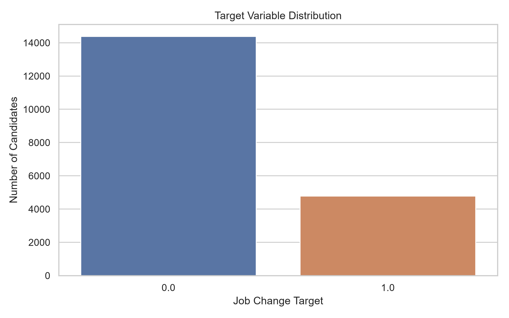
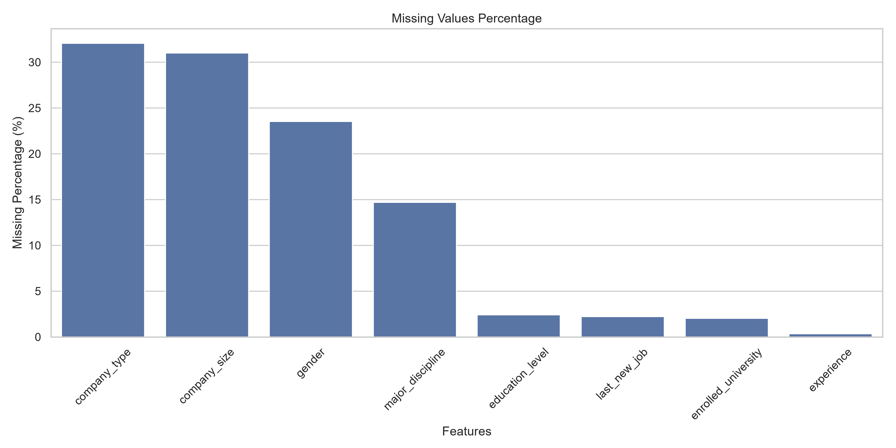
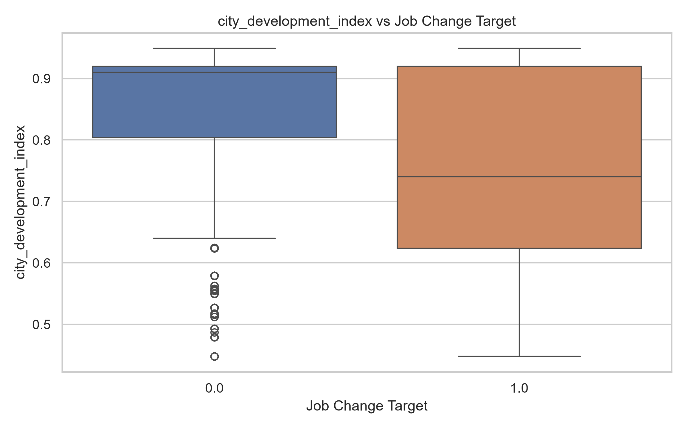
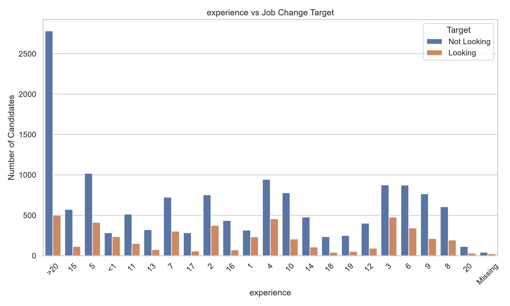
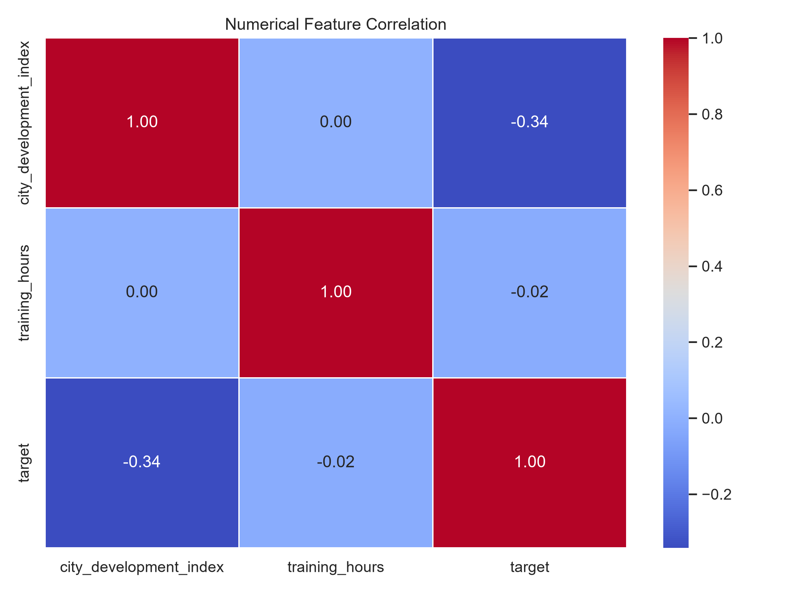
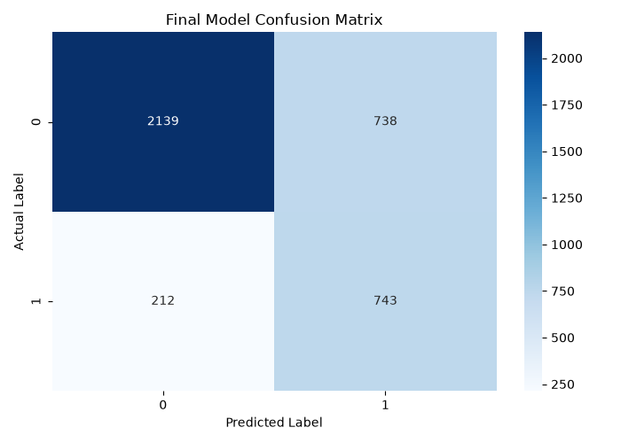
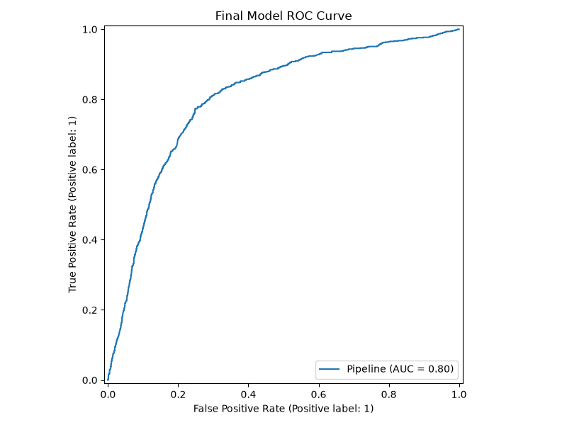

# Job Change Prediction | End-to-End Machine Learning

<p align="center">
  
  
  
  
</p>

## Overview

**Job Change Prediction** is an end-to-end Machine Learning classification project that predicts whether a candidate is likely to be looking for a job change.

The project focuses on helping an EdTech company identify potential job seekers after training by analyzing their demographic, educational, employment, and training-related information.

It covers the complete machine learning workflow, including data cleaning, exploratory data analysis, preprocessing, model development, class imbalance handling, cross-validation, hyperparameter tuning, final evaluation, and candidate prediction.

---

## Business Problem

An EdTech company provides training to candidates and wants to identify individuals who are genuinely interested in changing jobs.

Manually identifying these candidates can consume significant time and resources.

The objective is to build a classification model that helps identify potential job seekers and supports more efficient candidate categorization.

### Project Objectives

- Identify factors associated with job-change intentions.
- Analyze candidate characteristics through EDA.
- Handle missing values and categorical variables.
- Investigate and address class imbalance.
- Train and compare multiple classification algorithms.
- Evaluate model performance using appropriate metrics.
- Optimize model hyperparameters.
- Predict job-change intentions for new candidates.

---

## Dataset Information

The dataset contains **19,158 records and 14 original columns**.

After removing the unnecessary `enrollee_id` feature, 13 columns remain, including the target variable.

### Features

| Feature | Description |
|---|---|
| city | Candidate's city |
| city_development_index | City development index |
| gender | Candidate's gender |
| relevent_experience | Relevant work experience |
| enrolled_university | University enrollment status |
| education_level | Education qualification |
| major_discipline | Major academic discipline |
| experience | Years of experience |
| company_size | Previous company size |
| company_type | Previous company type |
| last_new_job | Time since last job change |
| training_hours | Training hours completed |
| target | Job-change intention |

### Target Variable

| Value | Meaning |
|---|---|
| 0 | Not looking for a job change |
| 1 | Looking for a job change |

### Target Distribution

| Class | Records | Percentage |
|---|---:|---:|
| 0 | 14,381 | 75.07% |
| 1 | 4,777 | 24.93% |

The dataset has an imbalanced target distribution, which makes recall, precision, and F1 Score important evaluation metrics.

---

## Exploratory Data Analysis

EDA was performed to understand the dataset, identify missing values, examine feature distributions, and investigate relationships between candidate characteristics and job-change intentions.

### EDA Visualizations

**Target Distribution**



**Missing Values Analysis**



**City Development Index vs Target**



**Experience vs Target**



**Correlation Matrix**



### Key Observations

- Approximately 24.93% of candidates belong to the positive target class.
- Missing values are present in several categorical features.
- City development index shows an association with job-change intentions.
- Candidates with less work experience show higher job-change intention rates in the analyzed data.
- Training hours alone show a relatively weak correlation with the target.

These observations describe patterns in the dataset and do not establish causal relationships.

---

## Data Preprocessing

The following preprocessing operations were implemented:

1. Data validation.
2. Duplicate record checking.
3. String cleaning.
4. Removal of unnecessary identifiers.
5. Separation of features and target.
6. Stratified train-test splitting.
7. Missing value imputation.
8. Categorical feature encoding.
9. Numerical feature scaling.

### Preprocessing Techniques

| Feature Type | Techniques |
|---|---|
| Numerical | Median Imputation, Missing Indicators, StandardScaler |
| Categorical | Most Frequent Imputation, OneHotEncoder |

### Train-Test Split

| Dataset | Records |
|---|---:|
| Training | 15,326 |
| Testing | 3,832 |
| Total | 19,158 |

- Training percentage: 80%
- Testing percentage: 20%
- Random State: 42
- Stratification: Enabled

The preprocessing transformer is fitted on training data and subsequently applied to testing data.

---

## Machine Learning Models

Five classification algorithms were implemented and compared.

- Logistic Regression
- Decision Tree Classifier
- Random Forest Classifier
- K-Nearest Neighbors (KNN)
- Gradient Boosting Classifier

### Baseline Model Comparison

| Model | Accuracy | Precision | Recall | F1 Score | ROC-AUC |
|---|---:|---:|---:|---:|---:|
| Gradient Boosting | 78.50% | 59.11% | 44.50% | 50.78% | 79.98% |
| KNN | 75.63% | 51.28% | 43.98% | 47.35% | 73.88% |
| Random Forest | 76.80% | 54.70% | 40.21% | 46.35% | 77.62% |
| Logistic Regression | 77.58% | 58.66% | 34.03% | 43.07% | 79.31% |
| Decision Tree | 71.29% | 42.38% | 42.20% | 42.29% | 61.94% |

Gradient Boosting achieved the highest baseline F1 Score.

---

## Handling Class Imbalance

The target variable contains significantly more negative-class observations than positive-class observations.

To investigate the impact of class imbalance, three experiments were performed:

- Baseline
- Random OverSampler
- Random UnderSampler

### Experiment Results

| Experiment | Accuracy | Precision | Recall | F1 Score | ROC-AUC |
|---|---:|---:|---:|---:|---:|
| Random OverSampler | 75.05% | 49.97% | 78.74% | **61.14%** | 80.24% |
| Random UnderSampler | 74.50% | 49.27% | 77.38% | 60.20% | 79.96% |
| Baseline | 78.50% | 59.11% | 44.50% | 50.78% | 79.98% |

Random OverSampler improved the model's ability to identify positive-class candidates.

Sampling was performed within the training pipeline to avoid applying oversampling to the test data.

---

## Regularization

Logistic Regression experiments were performed to investigate regularization and class weighting.

- L1 Regularization
- L2 Regularization
- Balanced Class Weight

L1 regularization produced 66 zero-valued coefficients out of 185 total coefficients, corresponding to approximately 35.68%.

---

## Cross Validation

Stratified 5-Fold Cross Validation was used to evaluate model performance across multiple training folds.

| Metric | Mean Score | Standard Deviation |
|---|---:|---:|
| Accuracy | 0.7423 | 0.0101 |
| Precision | 0.4891 | 0.0134 |
| Recall | 0.7282 | 0.0202 |
| F1 Score | 0.5850 | 0.0135 |
| ROC-AUC | 0.7804 | 0.0139 |

The cross-validation process used preprocessing and RandomOverSampler within the model pipeline.

---

## Hyperparameter Tuning

RandomizedSearchCV was used to optimize the Gradient Boosting model.

### Search Configuration

| Configuration | Value |
|---|---|
| Search Method | RandomizedSearchCV |
| Cross Validation | 5-Fold |
| Parameter Combinations | 15 |
| Total Model Fits | 75 |
| Scoring Metric | F1 Score |

### Best Cross-Validation Score

**F1 Score: 0.5888**

### Best Parameters

| Parameter | Selected Value |
|---|---:|
| n_estimators | 100 |
| max_depth | 5 |
| learning_rate | 0.05 |
| min_samples_split | 5 |
| min_samples_leaf | 4 |

The best tuned pipeline was saved as:

`artifacts/best_tuned_model.joblib`

---

## Final Model Evaluation

The optimized model was evaluated on the held-out test dataset.

### Final Performance

| Metric | Score |
|---|---:|
| Accuracy | **75.21%** |
| Precision | **50.17%** |
| Recall | **77.80%** |
| F1 Score | **61.00%** |
| ROC-AUC | **80.39%** |

### Confusion Matrix



### ROC Curve



### Classification Report

| Class | Precision | Recall | F1 Score | Support |
|---|---:|---:|---:|---:|
| 0 | 0.91 | 0.74 | 0.82 | 2,877 |
| 1 | 0.50 | 0.78 | 0.61 | 955 |

### Business Interpretation

The final model achieves 77.80% recall for the positive class.

This means it identifies a substantial proportion of candidates who are actually looking for a job change.

However, its precision is 50.17%, so predictions should be treated as candidate-screening assistance rather than definitive decisions.

Recruiter verification remains important before taking action.

---

## Candidate Prediction

A prediction module was developed to use the saved tuned model for new candidate records.

The module:

- Loads the trained model.
- Validates candidate input.
- Checks required features.
- Generates a prediction.
- Calculates job-change probability.

### Example Output

```text
========== CANDIDATE PREDICTION ==========

Prediction: 1
Result: Looking for Job Change
Job Change Probability: 0.5903
```

The example output represents a sample candidate prediction, not a verified real-world outcome.

Run the prediction module using:

```bash
python -m src.models.predict
```

---

## Project Architecture

```text
Project-03-Job-Change-Prediction/
│
├── artifacts/
│   └── best_tuned_model.joblib
│
├── config/
│
├── data/
│   ├── raw/
│   └── processed/
│
├── logs/
│
├── reports/
│   ├── figures/
│   ├── business_insights.txt
│   ├── cross_validation_results.csv
│   ├── final_model_results.csv
│   ├── hyperparameter_tuning_results.csv
│   ├── imbalance_experiment_results.csv
│   ├── model_evaluation_results.csv
│   └── regularization_results.csv
│
├── src/
│   ├── data/
│   │
│   ├── eda/
│   │   ├── business_insights.py
│   │   └── exploratory_analysis.py
│   │
│   ├── features/
│   │
│   ├── models/
│   │   ├── cross_validation.py
│   │   ├── evaluate_model.py
│   │   ├── final_evaluation.py
│   │   ├── hyperparameter_tuning.py
│   │   ├── imbalance_experiments.py
│   │   ├── predict.py
│   │   ├── regularization.py
│   │   └── train_model.py
│   │
│   ├── preprocessing/
│   │   ├── data_cleaning.py
│   │   ├── data_splitter.py
│   │   ├── prepare_data.py
│   │   └── preprocessing_pipeline.py
│   │
│   └── utils/
│       └── logger.py
│
├── main.py
├── requirements.txt
├── README.md
└── .gitignore
```

---

## Installation and Setup

### 1. Clone Repository

```bash
git clone https://github.com/aamir-analyst/ML-Pipeline.git
```

### 2. Navigate to Project Directory

```bash
cd ML-Pipeline/Project-03-Job-Change-Prediction
```

### 3. Create Virtual Environment

```bash
python -m venv .venv
```

### 4. Activate Virtual Environment

Windows PowerShell:

```powershell
.\.venv\Scripts\Activate.ps1
```

### 5. Install Dependencies

```bash
pip install -r requirements.txt
```

### 6. Add Dataset

Place the original dataset at:

```text
data/raw/jobs_data.csv
```

The dataset is not included in this repository.

### 7. Execute Complete Pipeline

```bash
python main.py
```

The main pipeline executes:

1. Data Cleaning
2. Data Preprocessing
3. Baseline Model Training
4. Baseline Model Evaluation
5. Class Imbalance Experiments
6. Regularization Experiments
7. Cross Validation
8. Hyperparameter Tuning
9. Final Model Evaluation

### Run Individual Analysis Modules

**Exploratory Data Analysis**

```bash
python -m src.eda.exploratory_analysis
```

**Business Insights**

```bash
python -m src.eda.business_insights
```

**Candidate Prediction**

```bash
python -m src.models.predict
```

---

## Generated Outputs

The project generates:

- Cleaned dataset
- Processed training and testing datasets
- Trained classification models
- Final tuned model pipeline
- Model evaluation results
- Cross-validation results
- Hyperparameter tuning results
- Imbalance experiment results
- Regularization experiment results
- Confusion matrices
- ROC curves
- Business insights report
- Execution logs

---

## Future Improvements

- Develop a web-based candidate prediction application.
- Build an interactive candidate analytics dashboard.
- Optimize the prediction threshold based on business requirements.
- Explore additional feature engineering techniques.
- Improve precision while maintaining useful recall.
- Add automated unit and integration tests.
- Implement model monitoring and deployment.

---

## Key Learnings

Through this project, I worked on:

- End-to-end Machine Learning pipeline development.
- Data cleaning and exploratory analysis.
- Feature preprocessing and transformation.
- Classification algorithms.
- Imbalanced dataset handling.
- Model evaluation and comparison.
- Cross-validation techniques.
- Hyperparameter optimization.
- Model persistence and inference.
- Git and GitHub project management.

---

## Author

**Aamir**

B.Sc. Data Science & Artificial Intelligence

Interested in Data Science, Machine Learning, and AI.

---

**Project:** Job Change Prediction  
**Domain:** Human Resources Analytics / EdTech  
**Type:** Binary Classification  
**Status:** Completed